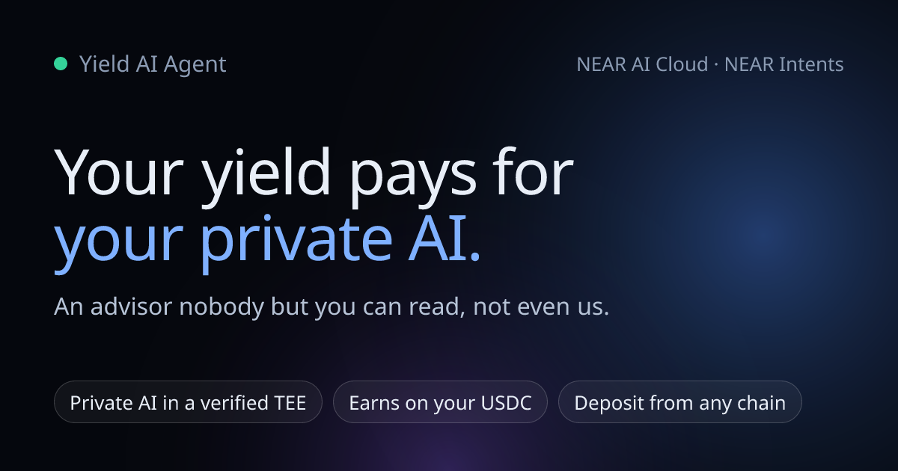
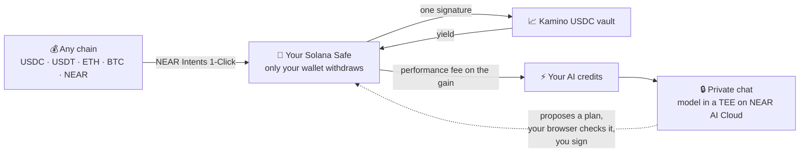
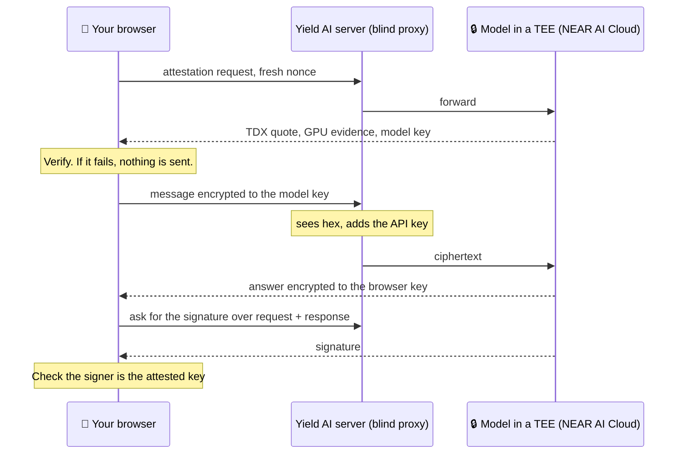

<div align="center">



# 🤖 Yield AI Agent

### Your yield pays for your private AI.

A chat advisor that nobody but you can read 🔒, an on-chain account that earns on your USDC 💸,<br>
and a meter that turns the fee on what you earn into AI credits ⚡

[](https://yieldai.app/agent)


[](LICENSE)

**Tracks:** `privacy` · `defi` · `agents`

</div>

Built at **NEAR HACKATHON** (2026-11-01 to 2026-11-14) on top of the existing [Yield AI](https://yieldai.app) product. Yield AI itself runs on Solana and Aptos and existed before the hackathon; what is judged here is the NEAR integration written in the window. See [Built before and built in the window](#-built-before-and-built-in-the-window).

Code: Sergei Sadkov ([@ssadkov](https://github.com/ssadkov)), Rustam Galiev ([@galiev-rustam](https://github.com/galiev-rustam)).

> [!WARNING]
> The live app runs on **mainnet with real funds**. Deposits are capped at 101 USDC.

## ⏳ Judge in a hurry?

| You have | Do this | You see |
|---|---|---|
| **1 minute** | Open [yieldai.app/agent](https://yieldai.app/agent) and click a starter question. No wallet. | The badge turns **Private · TEE ✓**, and the answer comes with today's rates. |
| **2 minutes** | Run the two `curl` lines in [step 2](#2-check-that-the-server-only-sees-ciphertext-2-minutes). | Our own server refuses plaintext: `400 E2EE v2 required`. |
| **5 minutes** | Connect a Solana wallet and follow [steps 3 to 6](#3-connect-a-wallet-phantom-solflare-or-backpack). | Money arrives from another chain, starts earning, and the yield starts paying for AI. |

**On this page:** [Problem](#-the-problem) · [What it is](#-what-this-is) · [Try it](#-try-it) · [How NEAR is used](#-how-near-is-used) · [Agentic wallet](#-the-agentic-wallet-propose-check-sign) · [AI credits](#-ai-credits) · [What the server sees](#-what-our-server-can-and-cannot-see) · [Limitations](#-limitations) · [Before / in the window](#-built-before-and-built-in-the-window) · [Run locally](#-run-locally)

## 🤔 The problem

Two things stop people from asking an AI about their money.

1. **The question is the secret.** "I have 40k USDC on Base, where do I put it?" tells the model's operator your balance, your wallet and your plans. With a normal AI API the app's server and the model provider both read it.
2. **A useful agent needs access to funds.** An advisor that can only talk is a search box. An agent that holds your keys is a liability.

On top of that, good private inference is not free, and a subscription is one more card on file.

## 🧩 What this is

- **A private chat.** Your browser verifies the model's TEE attestation, then encrypts every message to a key that only exists inside that enclave on NEAR AI Cloud. Our server forwards ciphertext and adds the API key. It cannot read the conversation, and neither can we.
- **An account that earns.** A Solana Safe (program [`yie1Jjq6…`](https://solscan.io/account/yie1Jjq6y3rjsiGkgMYnwTveSgpSrSh4n41JHRNyBih)) that only your wallet can move funds out of. It puts USDC into Kamino. You can fund it from 10 networks through NEAR Intents.
- **An agent that proposes and never signs.** The model reads live rates and your balances through tools and proposes a plan. The browser checks every transaction byte by byte against what you asked for before your wallet sees it.
- **AI that the yield pays for.** The Safe program takes a performance fee on Kamino gains only (2000 bps on chain, read on 2026-11-13). That fee is your AI budget. Everyone also gets a small free allowance, and credits can be bought with any listed token.

### The loop in one picture



## 🚀 Try it

Everything is on https://yieldai.app/agent. Steps 1 and 2 need no wallet and no money.

### 1. Ask without a wallet (1 minute)

| Do | See |
|---|---|
| Open the page. | The badge in the chat's top right goes from "Verifying TEE attestation" to **Private · TEE ✓**. Under the chat: "Try it without a wallet: 10 free requests left today." |
| Click "Where should I put 100 USDC, and what are the risks?" | The answer streams in with today's Kamino and Exponent rates (the model called `get_usdc_yields`) and, in most runs, a deposit card with 100 USDC prefilled. |
| Click "Explain a real transaction of the Safe program". | The model calls `explain_transaction` on a public mainnet deposit and says in plain words who paid, which programs ran (Yield AI Safe, Kamino), the fee, and what the Safe received. Any Solana signature or Solscan link you paste works the same way. |
| Click the green line under the answer: **✓ Signed inside the attested TEE by … · checked in your browser**. | **What this browser checked, in plain words**: one sentence per check (the enclave, the graphics card, the fresh proof, the encryption key, the signature on this answer), then **What left your browser**: a block of hex. That is the request as our server received it. **What the model was told** shows the full system prompt and the tool list. |

### 2. Check that the server only sees ciphertext (2 minutes)

| Do | See |
|---|---|
| Open DevTools → Network, send any message, open the `chat/completions` request to `/agent/api/near/v1/`. | Every `messages[].content`, tool name, tool description and tool argument is hex ciphertext. The response stream is ciphertext too. |
| Send a plaintext request to the proxy:<br>`curl -X POST https://yieldai.app/agent/api/near/v1/chat/completions -H 'content-type: application/json' -d '{"model":"z-ai/glm-5.3-flash","messages":[{"role":"user","content":"hi"}]}'` | `400 {"error":"E2EE v2 required"}`. The proxy refuses anything that is not an encrypted request to a whitelisted model. |
| `curl https://yieldai.app/agent/api/near/v1/models` | `404 {"error":"Path not allowed"}`. Only chat, pictures, attestation reports and response signatures pass. |

### 3. Connect a wallet (Phantom, Solflare or Backpack)

| Do | See |
|---|---|
| Click **Connect**, pick a Solana wallet. | The **Earn on USDC** card on the left with the current Kamino APY. No signature is asked yet. |
| Under the chat, click **Sign once** and sign the message (it moves no funds). | "AI credits: $0.05 · free left … · from your Safe yield … · bought …". Click the **i** to see the NEAR staking pool that funds the free allowance, read live from NEAR mainnet. |
| Ask "What's in my wallet, and what should I do with it?" | The model calls `get_my_account` and answers with your real wallet and Safe balances. |

### 4. Deposit from another chain through NEAR Intents (needs about $2 on any listed network)

| Do | See |
|---|---|
| **Earn on USDC → Deposit → Any chain · NEAR Intents**. If you have no Safe yet, press **Create my account** (one transaction, a little SOL for rent). | A network picker and a token picker: 27 assets on Base, Ethereum, Arbitrum, Solana, Tron, BNB Chain, Polygon, Avalanche, NEAR and Bitcoin. |
| Pick e.g. USDC on Base, enter an amount and your refund address on that network, press **Get quote**. | A one-time deposit address, the amount to send, and "At least N USDC" arriving. |
| Send the tokens to that address. | The status line follows NEAR Intents until the USDC lands in your Safe (a few minutes). The card then shows it as idle with a **Put it to work** link. |
| Click **Put it to work**. | One wallet signature moves the USDC into Kamino. "AI tokens your yield has paid for" starts counting. |

With USDC already on Solana: **Deposit → From this wallet** does the same in one signature (two on the first deposit).

### 5. Open chat, the uncensored model and pictures

Open chat unlocks once the Safe holds USDC or the wallet has bought credits.

| Do | See |
|---|---|
| Under the chat: **Top up with any token**, choose $1, pay. | NEAR Intents 1-Click delivers exactly $1 of USDC; the balance line shows "bought $1.00". |
| In the mode picker choose **Open chat**. | No system prompt, no tools. A model picker: Standard (GLM 5.3 Flash), Uncensored (DeepSeek V4.1 Flash, abliterated), Picture (FLUX.2 klein). |
| Choose **Picture**, type a description. | A picture, with "Drawn by FLUX.2 inside a verified TEE · encrypted to this browser · not saved in history". $0.012 is charged. |
| Attach a photo with the paperclip (or paste one) and ask about it. | The picture is downscaled in the browser and encrypted inside the message; the model answers about it. |

### 6. Withdraw

**Earn on USDC → Withdraw → All.** Two signatures: redeem from Kamino (the program sends its fee on the gain to the treasury), then send the USDC to your wallet. The card ends with "N USDC is back in your wallet".

## 🌐 How NEAR is used

### 🔒 NEAR AI Cloud: private inference



All of this runs in the browser; code in [`src/lib/advisor`](src/lib/advisor).

1. **Attestation before anything is sent** ([`nearProxy.ts`](src/lib/advisor/nearProxy.ts), `verifyModel`). The browser fetches the model's attestation with a fresh 32-byte nonce and verifies it with `@nearai/inference-sdk`: the Intel TDX quote and TCB status, the report data that binds our nonce to the model's signing key, the RTMR3 event log, MRCONFIGID, and NVIDIA GPU evidence when the enclave provides it. Every attestation must pass and they must agree on one key. If verification fails, nothing is sent to that model.
2. **End-to-end encryption** ([`e2ee.ts`](src/lib/advisor/e2ee.ts)). NEAR AI's E2EE v2: an ephemeral X25519 key, ECDH with the attested model key, HKDF-SHA256, XChaCha20-Poly1305. Messages, attached pictures, tool definitions, tool calls and tool results are each encrypted (`X-Encrypt-All-Fields: true`). The reply is encrypted to a key generated in the browser for that session; a field that does not decrypt discards the whole answer.
3. **A signature check on every answer** (`verifyAnswer`). After each reply the browser fetches NEAR's signature over the exact request and response bytes and checks that the signer is the one from the attestation it verified.
4. **A blind proxy** ([`src/app/api/near/[...path]/route.ts`](src/app/api/near/[...path]/route.ts), [`proxyPolicy.ts`](src/lib/advisor/proxyPolicy.ts)). The server holds the NEAR AI API key and nothing else. It forwards only: E2EE chat to three whitelisted models, E2EE picture requests to one, attestation reports, and response signatures. It rejects plaintext content, other models, platform tools, more than 1,200 output tokens and oversized bodies. It does not log bodies.

| Model | Used for | Price on NEAR AI (2026-11-12 / 14) |
|---|---|---|
| `z-ai/glm-5.3-flash` | Yield Advisor; Open chat "Standard" | $0.08 / $0.50 per 1M tokens in / out |
| `Qwen/Qwen3.8-27B` | Advisor fallback if the first model's attestation fails | $0.04 / $1.35 |
| `deepseek-ai/DeepSeek-V4.1-Flash-1017-abliterated` | Open chat "Uncensored" | $0.30 / $1.20 |
| `black-forest-labs/FLUX.2-klein-4B` | Open chat "Picture" | $0.012 per picture |

Only models that NEAR itself hosts with attestation are used. There is no fallback to a model without E2EE.

The advisor has five tools, all executed by the browser ([`tools.ts`](src/lib/advisor/tools.ts)):

| Tool | What it does |
|---|---|
| `get_usdc_yields` | Today's USDC rates for the destinations a Safe can deposit into. |
| `get_my_account` | The connected wallet and its Safe: balances, what it earned, the AI budget from yield. |
| `explain_transaction` | Paste a Solana signature or a Solscan link: who paid whom, which programs ran, the fee, and whether it touched your Safe ([`explainTx.ts`](src/lib/agent/explainTx.ts)). |
| `show_action_card` | A deposit or withdraw card in the chat with the amount prefilled. |
| `propose_plan` | A concrete allocation for the owner to review and sign. |

The model cannot sign, send or spend. Tool results are data: a transaction summary carries addresses, amounts and instruction names from a fixed character set, never memo text or free-form program logs.

### 🌉 NEAR Intents 1-Click: money in from any chain

| Where | What happens | Code |
|---|---|---|
| Deposit into the Safe from any chain | The server asks 1-Click for an `EXACT_INPUT` quote. The recipient is the Safe address derived on the server from the owner's key, never taken from the browser. The quote is refused unless 1-Click echoes the same recipient, asset, amount and refund address. Solana assets are paid by the connected wallet; other chains are sent by hand to the one-time deposit address. | [`safe-deposit/quote/route.ts`](src/app/api/safe-deposit/quote/route.ts), [`AnyChainDeposit.tsx`](src/components/agent/AnyChainDeposit.tsx), [`intentsAssets.ts`](src/lib/agent/intentsAssets.ts) |
| Buying AI credits | `EXACT_OUTPUT`: the buyer pays whatever the route costs and exactly $1 to $50 of USDC arrives. The deposit address is bound to the signed-in wallet in the ledger and credited when 1-Click reports success. | [`credits/quote/route.ts`](src/app/api/credits/quote/route.ts), [`credits/status/route.ts`](src/app/api/credits/status/route.ts) |
| Deposit card in the chat | The advisor's deposit card can route wallet USDC to the Safe through 1-Click. | [`chatDeposit.ts`](src/lib/agent/chatDeposit.ts), [`oneClick.ts`](src/lib/agent/oneClick.ts) |

The Safe address is a program-derived address, so 1-Click pays into its USDC token account directly. No JWT is used; 1-Click's standard 0.2% fee applies.

### 🪙 NEAR mainnet: the pool behind the free allowance

The free allowance is paid from NEAR staked through NEAR AI "Staking for Inference", whose rewards arrive as NEAR AI Cloud credits. [`aiPool.ts`](src/lib/advisor/aiPool.ts) reads that position from NEAR mainnet (`stake.dao`, `get_farm_position`) and the page shows the staked amount and the measured reward rate, with the time of the reading. Try it: `curl https://yieldai.app/agent/api/ai-pool`.

## 🔐 The agentic wallet: propose, check, sign

The Safe is a program-derived account of the Yield AI Solana program [`yie1Jjq6y3rjsiGkgMYnwTveSgpSrSh4n41JHRNyBih`](https://github.com/ssadkov/yield-ai-os-sol). It holds USDC and Kamino vault shares. Withdrawals go only to the owner's wallet. The program tracks the principal and takes its performance fee on a Kamino exit. The program and its transaction-building API existed before the hackathon.

What was written in the window is the path from a chat answer to a signature ([`safePlans.ts`](src/lib/agent/safePlans.ts)):

1. The model calls `propose_plan` or `show_action_card`. The browser validates the arguments in code: the strategy must be on the allowlist (today only `solana:kamino_usdc`), the amount must be within limits.
2. The Safe API builds an unsigned transaction.
3. `checkPlanTransaction` deserializes it before the wallet sees it and requires:
   - the owner is the only signer and the fee payer, and the priority fee is at most 0.01 SOL;
   - every instruction belongs to the Compute Budget program, the Safe program, or is the idempotent creation of one expected token account;
   - the Safe instructions are exactly the expected sequence for this action (for example `set_allocation, deposit, kamino_deposit, set_allocation`);
   - the amount equals the amount the user typed;
   - a new Safe gets the reviewed executor and an empty program allowlist.
4. Only then is the wallet asked to sign.

Tool results and anything the model reads are treated as data. A prompt injection can at most make the model propose a plan that this check rejects.

## ⚡ AI credits

One balance in dollars of NEAR AI usage, spent in this order ([`ledger.ts`](src/lib/credits/ledger.ts)):

1. **Free.** Without a wallet: 10 advisor requests a day per visitor, under one daily cap for all visitors. With a signed-in wallet: $0.05 a month.
2. **From your yield.** The performance fee your Safe has paid on Kamino exits (read from chain, [`realizedFees.ts`](src/lib/credits/realizedFees.ts)) plus the fee accrued on its current gain. The program collects the accrued part on exit, so it is granted before it is realized.
3. **Bought.** $1 to $50 with any listed token through NEAR Intents.

Each request is first reserved at an upper bound and then replaced by the cost NEAR AI bills for that `inference-id`. Pictures are charged at list price. The ledger (Neon Postgres) stores wallets, NEAR AI request ids, token counts, costs and purchases. It stores no prompts and no answers.

Sign-in is one Solana `signMessage` over a server challenge ([`session.ts`](src/lib/credits/session.ts)); it gates credits and Open chat, not privacy.

There is no email, no card and no account. The only identifier is a wallet address, and credits are paid for in crypto through NEAR Intents, so paying for the AI does not attach a name to it. A wallet address is pseudonymous, not anonymous: deposits and purchases are visible on chain.

## 👀 What our server can and cannot see

| Cannot see | Can see |
|---|---|
| Your messages, attached pictures, the model's answers and generated pictures | Your IP address (rate limiting; the no-wallet trial stores an HMAC of it, not the IP) |
| Tool names, arguments and results inside the chat | Your wallet address once you sign in |
| The chat history (kept in your browser's `localStorage`) | Which model you use, request sizes and timing |
| | Token counts and cost of each request (the last stream chunk carries usage in clear) |
| | That a tool ran: `get_usdc_yields` and `get_my_account` fetch this app's own API, the second with your wallet address |
| | Which transaction you asked about: `explain_transaction` sends the signature (public chain data) to this app's API, without your wallet address; the browser marks "your wallet" and "your Safe" itself |
| | Page views (Vercel Web Analytics) |

NEAR AI Cloud's gateway sees the same ciphertext. The plaintext exists in your browser and inside the attested enclave.

## 🚧 Limitations

- **Mainnet and real funds.** NEAR Intents has no testnet. Deposits are capped at 101 USDC while the Safe program has a single admin key.
- **Trust assumptions.** Privacy rests on Intel TDX and NVIDIA attestation and on NEAR AI's SDK that verifies them. The SDK is patched to tolerate a 2-minute clock skew in NVIDIA's token ([`patches/`](patches)).
- **Chat history is not encrypted at rest.** It sits in `localStorage` on your device. The encrypted, wallet-keyed memory described in [`docs/private-advisor.md`](docs/private-advisor.md) is not built.
- **Generated pictures have no response-signature check.** The request is encrypted to the attested key and the picture decrypts only with the browser's key, but NEAR's per-answer signature is verified for chat only.
- **One executable strategy.** Kamino USDC. Exponent fixed-rate PT is listed for comparison; the app cannot deposit into it.
- **The agent does not act on its own here.** Every transaction is signed by the owner. The Safe program has an executor role for automation; this app does not use it.
- **The fee-to-AI link is an off-chain ledger.** Credits are a service quota granted against the fee the program takes. They are not a token and not a claim on the pool. Moving collected fees into the NEAR stake is done by hand.
- **The no-wallet trial is keyed by IP** and can be exhausted by other users behind the same address.
- **Solana only in this demo.** Aptos is wired underneath (the wallet adapter is shared with the main app) and hidden with a flag.
- **Not audited.** Not financial advice. Rates are read live from Kamino and Exponent and change.

## 📅 Built before and built in the window

Hackathon rules Q-001, Q-002, Q-003 and Q-005.

**This repository was created on 2026-11-02.** Every commit is inside the window (2026-10-19 to 2026-11-14) except the content of one import commit:

- Baseline import: [`258c43b`](https://github.com/ssadkov/yield-ai-agent/commit/258c43b) "Import the wallet connection baseline from Yield AI".
- Everything written after it: https://github.com/ssadkov/yield-ai-agent/compare/258c43b...main

**Built before (baseline, not judged):**

| What | Where | Since |
|---|---|---|
| Yield AI app: wallets, Safes on Aptos, portfolio, bridge | `yieldai.app`, private repo | before the hackathon |
| Solana Safe program `yie1…` and its API that builds unsigned owner transactions (`/api/mobile/v1/*`) | [ssadkov/yield-ai-os-sol](https://github.com/ssadkov/yield-ai-os-sol), public | 2026-03 |
| Wallet connection files imported in `258c43b`: `src/lib/WalletProvider.tsx`, `SolanaProvider.tsx`, `solanaRpcEndpoint.ts`, `aptosWalletUtils.ts`, `wallet/getSolanaWalletAddress.ts`, `protocols/yield-ai/derivedSafeHost.ts`, `utils/addressNormalization.ts`, `src/components/SolanaWalletRestore.tsx`, `AptosWalletRestore.tsx` | this repo | from the main app |
| Chat UI pieces adapted from the main app's earlier chat panel (first written 2026-10-15): Markdown rendering and the local history format (`ChatMarkdown.tsx`, `history.ts`) | this repo | 2026-10-15 |

Changes to baseline code during the window: the main app got a proxy that serves this deployment at `yieldai.app/agent`; the Safe API stopped asking owners to extend a program allowlist (2026-11-04); the program's performance fee was set to 2000 bps on chain.

**Built in the window (judged):** everything else in this repository.

| Area | Code |
|---|---|
| Attestation, E2EE, response-signature check, blind proxy and its policy | `src/lib/advisor/nearProxy.ts`, `e2ee.ts`, `proxyPolicy.ts`, `src/app/api/near/` |
| Advisor: system rules, tools, turn loop, modes, models, pictures | `src/lib/advisor/knowledge.ts`, `tools.ts`, `runTurn.ts`, `modes.ts`, `models.ts`, `images.ts`, `imageFile.ts` |
| NEAR Intents: any-chain Safe deposit, credit purchase, asset list, 1-Click client | `src/app/api/safe-deposit/`, `src/app/api/credits/`, `src/lib/agent/intentsAssets.ts`, `oneClick.ts`, `chatDeposit.ts` |
| Plan checker and Safe actions | `src/lib/agent/safePlans.ts`, `solanaSafe.ts`, `src/app/api/solana-safe/` |
| Credits: ledger, sign-in, trial, realized fees, NEAR AI billing reconciliation | `src/lib/credits/` |
| AI pool reading from NEAR mainnet | `src/lib/advisor/aiPool.ts`, `src/app/api/ai-pool/` |
| USDC yields API for the advisor | `src/lib/agent/usdcYields.ts`, `src/app/api/usdc-yields/` |
| Transaction explainer for the advisor | `src/lib/agent/explainTx.ts`, `src/app/api/explain-tx/` |
| The page | `src/components/agent/`, `src/app/` |
| Probes used to check NEAR AI before building | `scripts/near-ai-e2ee-probe.mjs`, `scripts/near-ai-image-probe.mjs` |

**Libraries (all third-party, none of our own):** Next.js 15, React 19, Tailwind CSS 4, `@nearai/inference-sdk` 0.3.0 (patched, see `patches/`), `@noble/curves`, `@noble/ciphers`, `@solana/web3.js`, `@solana/wallet-adapter-*`, `@aptos-labs/wallet-adapter-*`, `@aptos-labs/derived-wallet-solana`, `@aptos-labs/ts-sdk`, `@neondatabase/serverless`, `react-markdown`, `remark-gfm`, `@vercel/analytics`. Token logos are from the Trust Wallet assets repository. External services: NEAR AI Cloud, NEAR Intents 1-Click, NEAR RPC, Kamino and Exponent APIs, Solana RPC, Neon.

Parts of the code were written with AI coding agents (Claude Code).

## 💻 Run locally

Requires Node 22.18 or later and pnpm 10.

```bash
pnpm install
cp .env.example .env.local   # then put your NEAR AI key in NEAR_AI_API_KEY
pnpm dev
```

Open http://localhost:3000/agent.

With only `NEAR_AI_API_KEY` set, the private chat, attestation, the proof line, the yields tool and the Earn card all work, and the chat is open to anyone who can reach the server. Get a key at https://cloud.near.ai and set a spend limit on it. Setting `DATABASE_URL` and `SESSION_SECRET` turns on credits, sign-in, the trial and the Open chat lock.

| Variable | Needed for | Notes |
|---|---|---|
| `NEAR_AI_API_KEY` | chat | Server only. Without it the proxy answers 503. |
| `DATABASE_URL` | credits | Neon Postgres. Tables are created on first use. |
| `SESSION_SECRET` | credits, trial | 32+ random characters. |
| `CREDITS_RECEIVER` | buying credits | Solana address that receives USDC from 1-Click. |
| `CREDITS_DESTINATION_ASSET` | optional | 1-Click asset id; default USDC on Solana. |
| `ADVISOR_FREE_USD_PER_MONTH` | optional | Default `0.05`. |
| `ADVISOR_TRIAL_REQUESTS_PER_DAY`, `ADVISOR_TRIAL_USD_PER_DAY` | optional | Defaults `10` and `0.1`. |
| `AI_POOL_NEAR_ACCOUNT`, `AI_POOL_PRODUCT_ID` | optional | Whose NEAR AI stake the pool meter reads. |
| `SOLANA_RPC_URL` | optional | Default is the public mainnet RPC. |
| `SOLANA_SAFE_API_ORIGIN`, `YIELD_AI_API_ORIGIN` | optional | Upstream APIs. |

More detail in [`docs/env.md`](docs/env.md). Never commit `.env.local`.

Checks:

```bash
pnpm test        # unit tests: proxy policy, plan checker, ledger, trial, sessions, yields
pnpm typecheck
pnpm build
node scripts/near-ai-e2ee-probe.mjs   # encrypted round trip against NEAR AI, needs the key
```

A Solana wallet on `localhost` works for the chat and for reading balances. The Safe address depends only on the wallet, so it is the same on every host.

## 🚢 Deploy

The app has `basePath: /agent` and is a separate Vercel project. In production the main Yield AI app proxies `https://yieldai.app/agent` to it, so the browser stays on `yieldai.app`. The `*.vercel.app` URL is only for smoke tests. The hosted demo stays up at least until 2026-11-25.

## 📄 License

[MIT](LICENSE).
